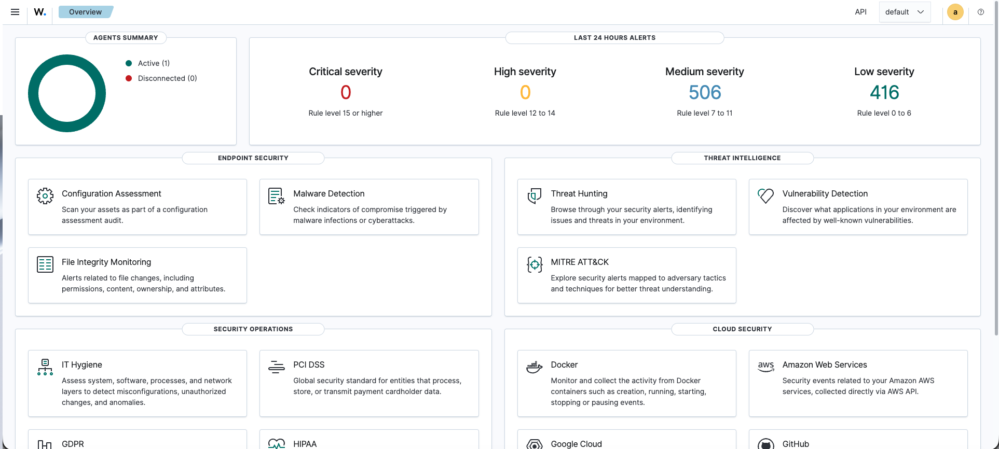
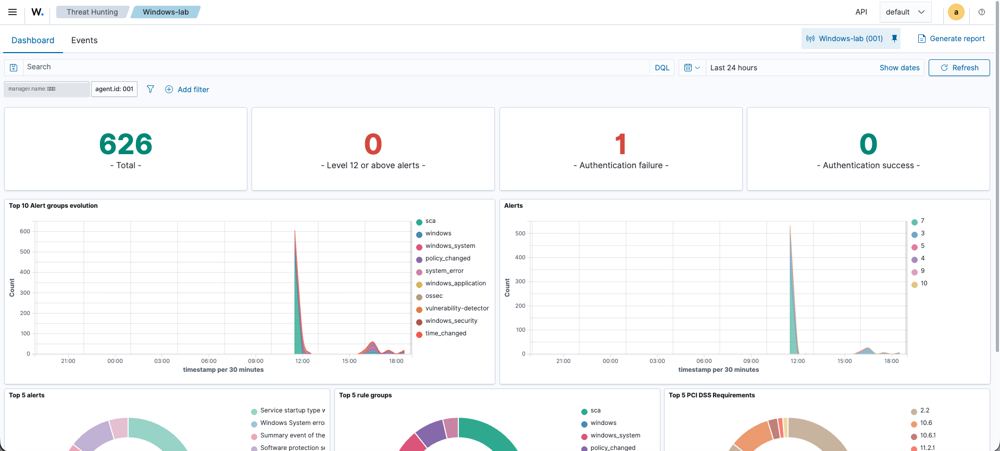
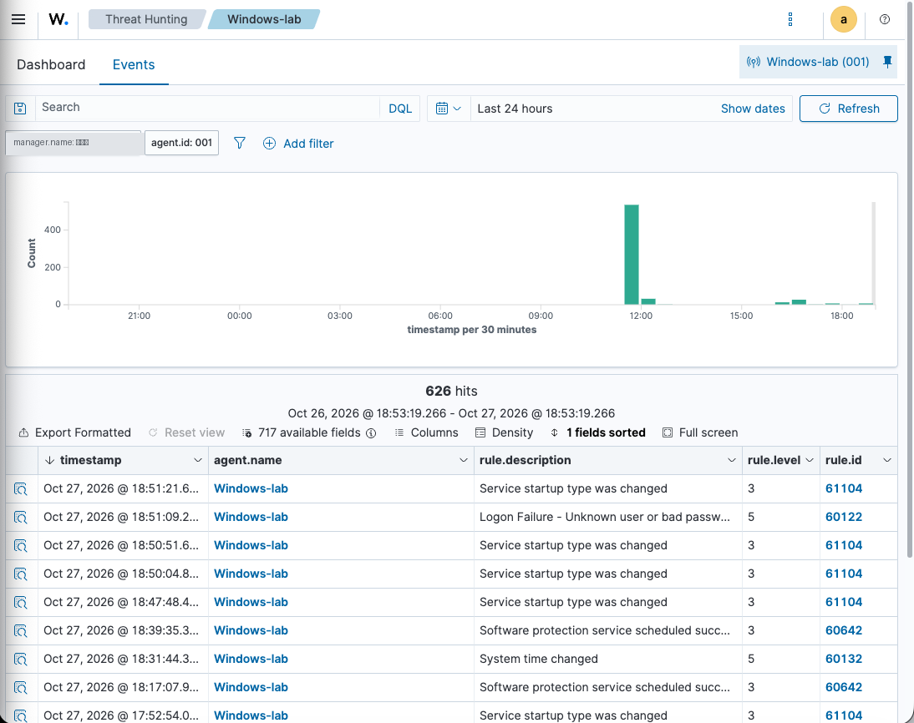

# Wazuh SIEM Home Lab

A self-hosted SIEM lab built on a MacBook (Apple Silicon M4) with UTM, used to learn how security monitoring works end to end: from endpoint telemetry to alerts on a dashboard.

> **Why this project?** I'm specialising in cybersecurity governance and GRC. Running a SIEM myself helps me understand what controls like *logging & monitoring* (ISO 27001 A.8.15–8.16, NIS2 Art. 21) actually look like in practice.

---

## 🏗️ Architecture

```
┌──────────────────────── MacBook M4 (UTM) ────────────────────────┐
│                                                                   │
│   ┌─────────────────────────┐        ┌─────────────────────────┐  │
│   │  Ubuntu Server 24.04    │◄───────│  Windows 11             │  │
│   │  Wazuh manager,         │ agent  │  Wazuh agent            │  │
│   │  indexer & dashboard    │ events │  (monitored endpoint)   │  │
│   └─────────────────────────┘        └─────────────────────────┘  │
│                ▲                                                  │
│                │ HTTPS (dashboard)                                │
│           macOS browser                                           │
└───────────────────────────────────────────────────────────────────┘
```

| Component | Details |
|---|---|
| Host | MacBook with Apple M4, virtualisation with UTM |
| SIEM server | Ubuntu Server 24.04 LTS, Wazuh (latest release, October 2026) — all central components |
| Endpoint | Windows 11 VM with the Wazuh agent |

---

## ⚙️ Setup summary

1. Created an Ubuntu Server 24.04 VM in UTM and installed the latest Wazuh release (manager, indexer and dashboard).
2. Created a Windows 11 VM and installed the Wazuh agent, enrolling it with the manager.
3. Confirmed the agent appeared as **active** in the Wazuh dashboard.
4. Made configuration changes on the endpoint and verified they were reflected as events in the dashboard.

---

## 📸 Screenshots

**Wazuh overview:** 1 active agent, 922 alerts in the last 24 hours (0 critical, 0 high, 506 medium, 416 low).



---

## 🔎 Detection example: failed authentication (MITRE ATT&CK T1110 – Brute Force)

To move beyond baseline noise, I generated a failed-login event on the Windows endpoint and confirmed Wazuh detected it. The attempt triggered **rule 60122 – *Logon Failure - Unknown user or bad password*** (level 5), visible both in the *Authentication failure* counter on the endpoint dashboard and in the Threat Hunting event stream.

| Endpoint dashboard | Detected event |
|---|---|
|  |  |

**Mapping:** this maps to MITRE ATT&CK technique **T1110 (Brute Force)** and supports ISO 27001 control **A.8.15 (Logging)** — the kind of detection a SOC relies on to spot credential-guessing.

---

## 🧠 Lessons learned

- **OS version compatibility matters.** I first tried the newest Ubuntu release (26.04), but Wazuh didn't behave as expected on it. Switching to **Ubuntu 24.04 LTS** solved it. Takeaway: always check the vendor's supported platforms before deploying, the same way an organisation should validate compatibility before rolling out a security tool.
- **Volume ≠ insight.** With just one endpoint, the dashboard registered **922 alerts in 24 hours** (506 medium, 416 low, 0 high/critical). Most are routine events and configuration checks, not attacks. The real skill is triage: knowing which alerts matter and tuning out noise. The next step is generating real attack activity to see what *high-severity* detections look like (see roadmap).

---

## 🗺️ Roadmap

- [x] Deploy Wazuh server on Ubuntu 24.04
- [x] Enrol a Windows 11 endpoint with the agent
- [x] Detect a failed-authentication event (rule 60122, MITRE T1110)
- [ ] Add more detection cases (File Integrity Monitoring, malware test file)
- [ ] Map every detection to **MITRE ATT&CK** techniques
- [ ] Enable File Integrity Monitoring on sensitive folders and document alerts
- [ ] Write a short report linking findings to ISO 27001 / NIS2 controls

---

## 📚 References

- [Wazuh documentation](https://documentation.wazuh.com/)
- [MITRE ATT&CK](https://attack.mitre.org/)
